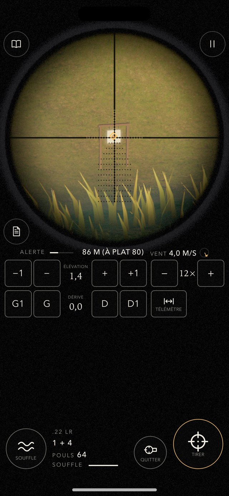
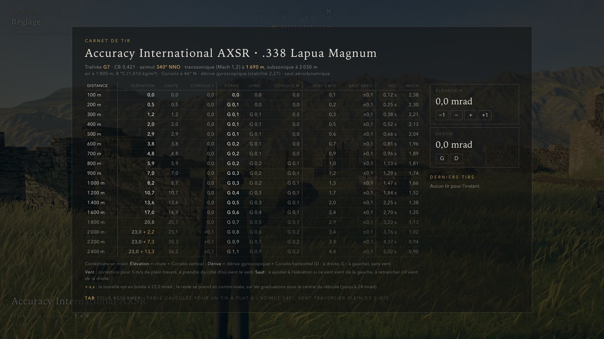

# ~~Faucon~~ Pigeon perché

Jeu de tir de précision à la troisième personne, dans le navigateur. Trois cartes, de 65 m à 2 500 m, dix-sept carabines réelles et une balistique calculée (traînée G1/G7, vent, Coriolis, dérive gyroscopique). Se joue sur ordinateur et sur téléphone tenu à la verticale.


Aucune effusion de sang : les cibles sont des plaques, des ballons, des silhouettes d'acier qui basculent, du matériel.

## Sommaire

- [Installation](#installation)
- [Les trois niveaux](#les-trois-niveaux)
- [Commandes](#commandes)
- [Sur téléphone](#sur-téléphone)
- [Carabines et calibres](#carabines-et-calibres)
- [Balistique](#balistique)
- [Bâtiments, routes et rivières](#bâtiments-routes-et-rivières)
- [Tests](#tests)
- [Organisation du code](#organisation-du-code)
- [Limites connues](#limites-connues)
- [Licences](#licences)

## Installation

### Prérequis

- [Node.js](https://nodejs.org) 22 ou plus récent (Vite 8 l'exige), avec npm.
- Un navigateur récent avec WebGL 2 : Chrome, Edge, Firefox ou Safari.
- Environ 900 Mo de disque avec les dépendances.

Rien n'est installé globalement : toutes les dépendances restent dans le dossier du projet.

### Lancer en développement

```bash
git clone https://github.com/NeustaSCV/pigeonperche-web.git
cd pigeonperche-web
npm install
npm run dev
```

Ouvrez l'adresse affichée (http://127.0.0.1:5173). Jouez au casque. Le premier chargement d'une carte prend quelques secondes.

### Construire la version statique

```bash
npm run build
npm run preview
```

`npm run build` vérifie les types puis écrit le site dans `dist/`. Ce dossier se dépose tel quel sur n'importe quel hébergement statique : les chemins sont relatifs, aucun serveur applicatif n'est nécessaire. `npm run preview` le sert en local pour contrôle.

### Essayer sur un téléphone

```bash
npm run dev -- --host
```

Vite affiche une adresse « Network » (par exemple `http://192.168.1.20:5173/`). Ouvrez-la sur un téléphone relié au même Wi-Fi, tenu à la verticale.

### Régénérer un relief

Les reliefs sont fournis dans `public/terrain/<niveau>/`. Pour les recalculer après avoir modifié une carte :

```bash
npm run gen:terrain -- facile
npm run gen:terrain -- standard
npm run gen:terrain -- avance
```

### Installer le navigateur des tests de bout en bout

Les tests unitaires n'ont besoin de rien de plus. Les tests de bout en bout pilotent Chromium, installé dans le projet :

```bash
npm run e2e:install
```

## Les trois niveaux

Le niveau se choisit au menu. Chaque niveau est une carte distincte, avec son relief, son site de tir, ses cibles et ses aides. `?level=facile`, `?level=standard` ou `?level=avance` dans l'adresse ouvre directement une carte.

### Facile : le Guet


Une ferme close sur un coteau bocager, face à un bourg abandonné. Huit objectifs de 65 m à 596 m : plaques, ballon, silhouette à une fenêtre du moulin, cible mobile, timbre de l'horloge du clocher, passerelle du château d'eau, toit de l'hôpital. Télémètre, vent affiché et point d'impact prédit. Le tutoriel se joue ici.


### Standard : la haute ruine


Une ruine au sommet d'une montagne, une vallée, un village, un campement. Dix objectifs et onze cibles de 87 m à 1 251 m, dont un drone, un véhicule en patrouille et une sentinelle. Télémètre disponible, vent à lire.

### Avancé : le Rebord


Un poste d'observation au bord d'un haut plateau à 900 m d'altitude, au-dessus d'une plaine industrielle. Neuf objectifs de 800 m à 2 500 m, dont le mile (1 609 m), dans l'esprit des compétitions de tir à très longue distance. Aucune aide, tous les effets balistiques actifs : le carnet de tir devient indispensable.


## Commandes

Les touches sont lues par position physique : ZQSD sur un clavier français, WASD sur un clavier anglais.

| Action | Touche |
|---|---|
| Se déplacer | Z Q S D (W A S D) |
| Regarder | Souris |
| Courir | Maj gauche |
| Accroupi / couché / se relever | C / X / Espace |
| Épauler ou quitter la lunette | Clic droit ou F |
| Tirer | Clic gauche |
| Retenir son souffle | Espace ou Maj, en lunette |
| Grossissement | Molette |
| Tourelle d'élévation | ↑ ↓ par clics de 0,1 mrad (Maj droite : 1 mrad) |
| Tourelle de dérive | ← → |
| Télémètre | T (niveaux facile et standard) |
| Recharger | R |
| Râtelier, changer d'arme | E, sous l'abri du site de tir |
| Carnet de tir | Tab |
| Relire le briefing | B |
| Afficher les images par seconde | H |
| Pause | Échap |
| Passer le tutoriel | P |

On marche librement sur tout le site de tir, jusqu'à une limite visible : rebord de falaise, pente trop raide, mur ou clôture.

Couché, l'arme repose sur son bipied. Accroupi contre un appui, elle tremble deux fois plus ; sans appui, quatre fois plus. Le pouls monte quand on court et met une vingtaine de secondes à redescendre. Une boussole et une flèche guident vers le poste conseillé pour l'objectif en cours.

## Sur téléphone

 

Sur un appareil tactile, le jeu affiche ses commandes à l'écran et se joue en portrait ; à l'horizontale, il demande de redresser le téléphone. Les tablettes acceptent les deux sens.

- **Hors lunette** : manette flottante sous le pouce gauche, regard en glissant partout ailleurs, boutons de posture, d'épaulement et de rechargement sous le pouce droit.
- **En lunette** : le champ occupe le haut de l'écran ; dessous, les tourelles (0,1 et 1 mrad), le grossissement et le télémètre ; tout en bas, Souffle, Quitter et Tirer.
- **Gestes du navigateur neutralisés** : double tap, pincement de page, défilement élastique.
- **iPhone** : Safari n'offre pas de plein écran à une page web. Ajouter la page à l'écran d'accueil (Partager, puis « Sur l'écran d'accueil ») retire les barres du navigateur.

`?touch=1` et `?touch=0` forcent ou désactivent les commandes tactiles.

## Carabines et calibres


Chaque arme est une carabine réelle avec une munition réelle. Les modèles 3D sont construits par code d'après des photos de référence ; aucune image ni marquage de fabricant n'est embarqué.

| Gamme | Carabine | Calibre |
|---|---|---|
| Initiation | CZ 457 Varmint | .22 LR |
| Standard | Tikka T3x Tac A1 | .223 Rem, 6.5 Creedmoor |
| Standard | Ruger Precision Rifle | .308 Win, .308 subsonique avec modérateur |
| Standard | Sako TRG 42 | .300 Win Mag |
| Standard | PGM 338 | .338 Lapua Magnum |
| Intermédiaire | Savage 110 Elite Precision | 6 mm Creedmoor |
| Intermédiaire | Bergara B-14 HMR | 6.5 PRC |
| Intermédiaire | Seekins Havak PH2 | 7 mm PRC |
| Intermédiaire | Barrett MRAD | .300 PRC |
| Intermédiaire | Accuracy International AXSR | .338 Lapua Magnum, balle de 300 gr |
| Longue distance | Tubb Adaptive Target Rifle | .33 XC |
| Longue distance | Desert Tech HTI | .375 CheyTac |
| Longue distance | CheyTac M200 Intervention | .408 CheyTac |
| Longue distance | Barrett M99 | .416 Barrett |
| Longue distance | Steyr HS .50 M1 | .50 BMG |

Chaque niveau propose une partie de cet arsenal au râtelier (douze armes au plus).

## Balistique



- **Vol** : intégration de Runge-Kutta d'ordre 4, traînée G1 ou G7 selon la balle, vent échantillonné le long de la trajectoire, passage transsonique.
- **Effets avancés**, activés par niveau : force de Coriolis et effet Eötvös (latitude et azimut de tir), dérive gyroscopique (stabilité de Miller, formule de Litz), saut aérodynamique dû au vent traversier, densité de l'air selon l'altitude, la température et la pression, y compris le long d'une trajectoire qui descend dans une vallée.
- **Carnet de tir** (Tab) : table de l'arme en mrad. Sur le niveau avancé, il décompose la correction (chute, vent, dérive gyroscopique, Coriolis horizontal et vertical, saut aérodynamique), donne le temps de vol, le Mach à l'impact, la distance de passage transsonique, et la part à prendre en contre-visée quand la tourelle arrive en butée.
- **Ordres de grandeur à 2 500 m** : 4,6 à 5,7 s de vol, 1,5 à 2,5 m de dérive gyroscopique, 50 à 60 cm de Coriolis dans chaque axe.

Les données de munition (masse, vitesse, coefficient balistique, pas de rayure) et leurs sources sont en commentaire dans `src/config/weapons.ts`. Les tests comparent le solveur à des tables publiées par Lapua, Federal et Hornady ; les références sont dans `tests/reference-tables.json`.

Limites du modèle : les calibres .375 CheyTac, .408 CheyTac et .50 BMG volent en G1 faute de coefficient G7 publié, donc un peu trop bien dans le transsonique. Au-delà de 500 yards, les nouvelles charges ne sont validées que par cohérence physique, faute de tables publiées.

## Bâtiments, routes et rivières

Les bâtiments du décor (église, moulin, hôpital, château d'eau, sanatorium, aciérie, mine, tour de refroidissement, siège de la Compagnie, halte du passage à niveau…) viennent d'une banque de modèles générés par code, dans `src/buildings/bank/`. L'adaptateur `src/buildings/` les fusionne en deux maillages, fournit une version lointaine et enregistre leurs collisions : les murs arrêtent les balles, les fenêtres et les brèches les laissent passer.

Chaque bâtiment est relié au réseau de sa carte par une route, un chemin ou une allée inscrits dans le relief, avec un pont à chaque franchissement de rivière. Sur la carte avancée, une rivière traverse la plaine près de la centrale thermique, qui y puise par une station de pompage.

## Tests

```bash
npm test                 # 160 tests unitaires (balistique, vol, lots des bâtiments)
npm run build            # vérification des types puis construction
```

Tests de bout en bout (après `npm run e2e:install`). Chaque script accepte `-- --level facile|standard|avance` et vise `standard` par défaut :

```bash
npm run e2e:smoke        # menu, briefing, jeu, carnet, pause
npm run e2e:mission      # un tireur automatique joue toute la mission
npm run e2e:mission:portrait
npm run e2e:matrix       # chaque cible est visible d'au moins un poste
npm run e2e:walk         # parcours à pied vers chaque poste, et marche droit vers le bord dans huit directions
npm run e2e:mobile       # commandes tactiles en portrait
npm run e2e:tutorial     # les 16 étapes du tutoriel
npm run e2e:rifles       # cotes et coût des 17 modèles d'armes
npm run e2e:physics      # tir réel contre solution calculée, effets avancés
npm run e2e:buildings    # banc d'essai des bâtiments
npm run e2e:perf         # temps par image des vues de référence
PLAYWRIGHT_BROWSERS_PATH=0 node e2e/zone.mjs     # zone de marche : aucune limite invisible
PLAYWRIGHT_BROWSERS_PATH=0 node e2e/routes.mjs   # captures des voies d'accès et des cours d'eau
```

Les scripts lancent leur propre serveur ; la variable `HR_URL` les dirige vers un serveur déjà lancé (par exemple `HR_URL=http://127.0.0.1:4173/` avec `npm run preview`). Les captures vont dans `e2e/out/`.

## Organisation du code

```
index.html, vite.config.ts     point d'entrée et configuration
src/
  core/        moteur de rendu, post-traitement, entrées, chargement des assets
  levels/      un dossier par carte (facile, standard, avance) + le contrat dans README.md
  world/       relief, végétation, ciel, vent, eau, maçonnerie
  buildings/   adaptateur et banque de bâtiments
  ballistics/  solveur, environnement, vol, solution de tir
  config/      fiches des armes
  weapons/     mécanique de la carabine, lunette, modèles 3D
  player/      déplacements et personnage
  game/        boucle de jeu, tirs, cibles, mission, tutoriel
  audio/       moteur sonore entièrement synthétisé
  ui/          interface, commandes tactiles, styles
public/        relief, textures, modèles, ciel, police du titre, icônes
tools/         générateur de relief et d'icônes
tests/         tests unitaires (Vitest)
e2e/           tests de bout en bout (Playwright)
docs/captures/ images de ce README
```

Pour ajouter une carte, lisez `src/levels/README.md` : un niveau est un dossier, reconnu sans toucher aux fichiers communs.

## Limites connues

- **Jamais joué de bout en bout par une personne sur les trois cartes.** Tout a été vérifié par tests automatisés et par lecture de captures. Les mouvements, le rythme et le confort restent à juger en jouant.
- **Son** : entièrement synthétisé, vérifié par le code et non à l'oreille.
- **Téléphone réel** : seul le niveau d'origine a été ouvert sur un iPhone. Les commandes tactiles sont testées dans un navigateur de bureau en fenêtre portrait.
- **Mission standard automatisée** : le tireur automatique prend parfois un tir de plus sur une cible mobile (véhicule), selon l'instant où le coup part.
- **Personnage** : silhouette simple, sans animation de visage.
- **Ciel** : une seule photographie de ciel, éclaircie par niveau.
- **Rivières des cartes facile et standard** : vues exactement de dessus, elles apparaissent par plaques.
- **Titre** : la lettre P manuscrite se lit un peu comme un R.

## Licences

Assets (textures, modèles, ciel, police) et bibliothèques : voir [CREDITS.md](CREDITS.md). Les textures, modèles et ciel sont sous CC0 ; three.js, postprocessing et three-mesh-bvh sous licence MIT ; la police du titre, Rock Salt, sous Apache 2.0.
