# ~~Faucon~~ Pigeon perché

Jeu de tir de précision à la troisième personne, dans le navigateur. Six cartes en deux campagnes, de 65 m à 2 500 m, dix-sept carabines réelles et une balistique calculée (traînée G1/G7, vent, Coriolis, dérive gyroscopique). Se joue sur ordinateur et sur téléphone tenu à la verticale.

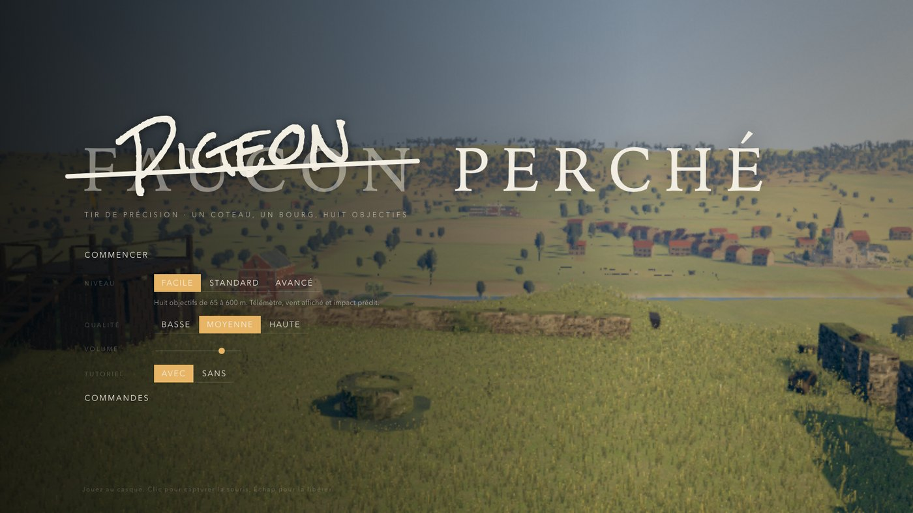

Aucune effusion de sang : les cibles sont des plaques, des ballons, des silhouettes d'acier qui basculent, du matériel.

## Sommaire

- [Installation](#installation)
- [Les six cartes](#les-six-cartes)
- [Commandes](#commandes)
- [Scores et classements](#scores-et-classements)
- [Sur téléphone](#sur-téléphone)
- [Carabines et calibres](#carabines-et-calibres)
- [Balistique](#balistique)
- [Bâtiments, routes et rivières](#bâtiments-routes-et-rivières)
- [Déploiement](#déploiement)
- [Tests](#tests)
- [Organisation du code](#organisation-du-code)
- [Licences](#licences)

## Installation

### Prérequis

- [Node.js](https://nodejs.org) 22 ou plus récent (Vite 8 l'exige), avec npm.
- Un navigateur récent avec WebGL 2 : Chrome, Edge, Firefox ou Safari.
- Environ 900 Mo de disque avec les dépendances.

Rien n'est installé globalement : toutes les dépendances restent dans le dossier du projet.

### Lancer en développement

```bash
git clone https://github.com/NeustaSCV/pigeonperche-web.git
cd pigeonperche-web
npm install
npm run dev
```

Ouvrez l'adresse affichée (http://127.0.0.1:5173). Jouez au casque. Le menu s'affiche tout de suite, sur des vues de cibles prises à la lunette ; la carte choisie se charge en quelques secondes quand on clique sur « Commencer ».

### Construire la version statique

```bash
npm run build
npm run preview
```

`npm run build` vérifie les types puis écrit le site dans `dist/`. Ce dossier se dépose tel quel sur n'importe quel hébergement statique : les chemins sont relatifs, aucun serveur applicatif n'est nécessaire (le classement est alors propre à chaque navigateur, voir [Scores et classements](#scores-et-classements)). `npm run preview` le sert en local pour contrôle. Pour un classement commun à tous les joueurs, voir [Déploiement](#déploiement).

### Essayer sur un téléphone

```bash
npm run dev -- --host
```

Vite affiche une adresse « Network » (par exemple `http://192.168.1.20:5173/`). Ouvrez-la sur un téléphone relié au même Wi-Fi, tenu à la verticale.

### Régénérer un relief

Les reliefs sont fournis dans `public/terrain/<niveau>/`. Pour les recalculer après avoir modifié une carte :

```bash
npm run gen:terrain -- facile
```

L'argument est l'identifiant de la carte : `facile`, `standard`, `avance`, `fete`, `phare` ou `plaine`.

### Installer le navigateur des tests de bout en bout

Les tests unitaires n'ont besoin de rien de plus. Les tests de bout en bout pilotent Chromium, installé dans le projet :

```bash
npm run e2e:install
```

## Les six cartes

Le menu propose deux campagnes de trois cartes, une par difficulté : « La vallée » (`facile`, `standard`, `avance`) et « Lieux oubliés » (`fete`, `phare`, `plaine`). Chaque carte a son relief, son site de tir, ses cibles, ses aides et son classement. `?level=<identifiant>` dans l'adresse ouvre directement une carte.

### La vallée

#### Facile : le Guet

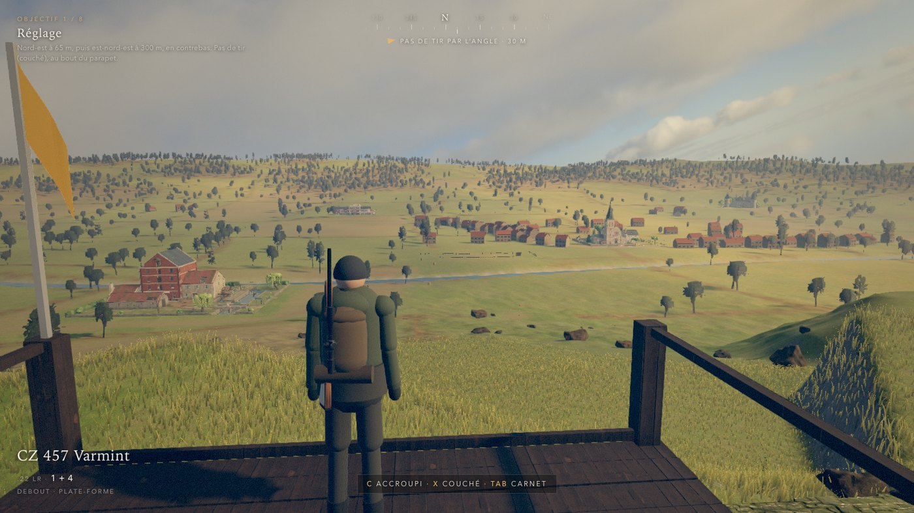

Une ferme close sur un coteau bocager, face à un bourg abandonné. Huit objectifs de 65 m à 596 m : plaques, ballon, silhouette à une fenêtre du moulin, cible mobile, timbre de l'horloge du clocher, passerelle du château d'eau, toit de l'hôpital. Télémètre, vent affiché et point d'impact prédit. Le tutoriel se joue ici.

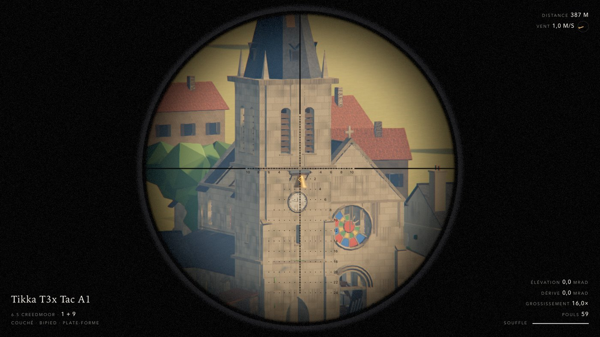

#### Standard : la haute ruine

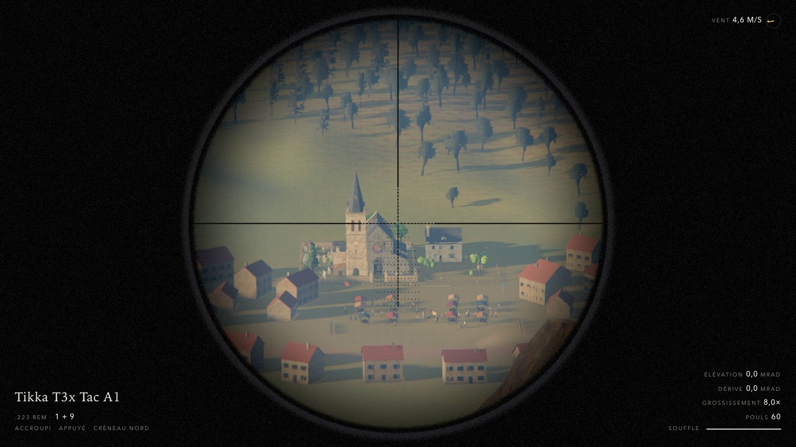

Une ruine au sommet d'une montagne, une vallée, un village, un campement. Dix objectifs et onze cibles de 87 m à 1 251 m, dont un drone, un véhicule en patrouille et une sentinelle. Télémètre disponible, vent à lire.

#### Avancé : le Rebord

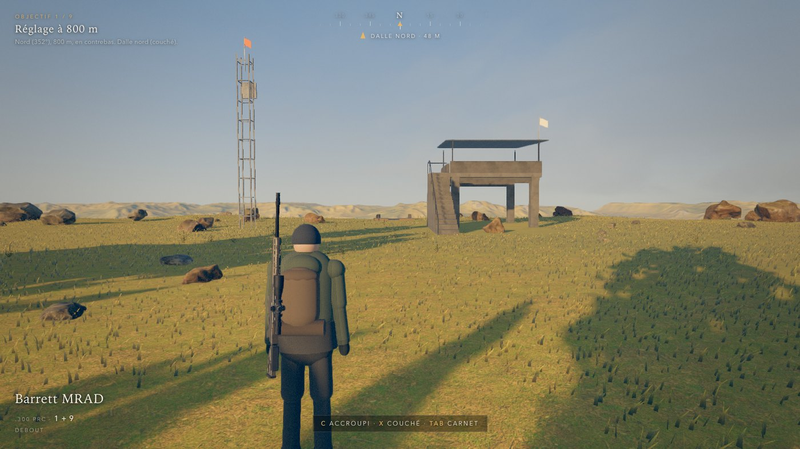

Un poste d'observation au bord d'un haut plateau à 900 m d'altitude, au-dessus d'une plaine industrielle. Neuf objectifs de 800 m à 2 500 m, dont le mile (1 609 m), dans l'esprit des compétitions de tir à très longue distance. Aucune aide, tous les effets balistiques actifs : le carnet de tir devient indispensable.

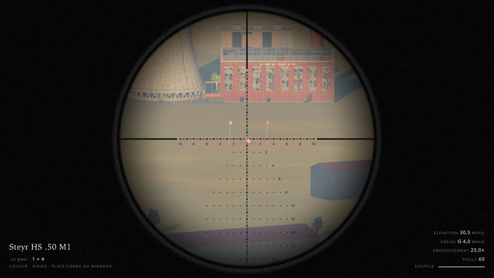

### Lieux oubliés

Trois lieux abandonnés de la banque de bâtiments, vus d'en haut. Les missions y sont plus joueuses : séries chronométrées, objectifs à tirer dans l'ordre, compte à rebours, alerte. Une seule cible se déplace par carte, et elle marque toujours l'arrêt : on ne tire jamais obligatoirement sur une cible en mouvement. Chaque carte accorde ses propres points de bonus, en plus du score habituel.

#### Facile : La Fête foraine

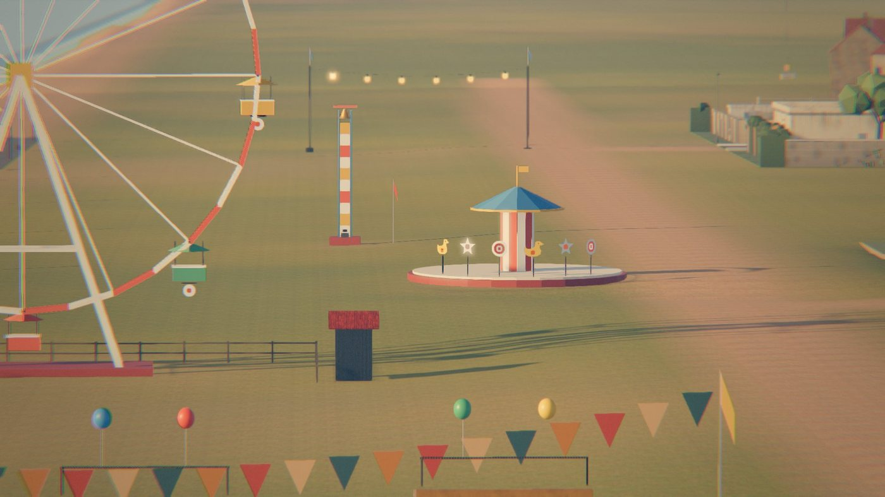

Fin de journée sur une station balnéaire. Vous êtes sur une terrasse de bois, au sommet du Grand Hôtel, et la fête fermée s'étend à vos pieds le long de la mer : c'est un stand de tir géant. Six séries, de 68 à 420 m : deux plaques pour régler la lunette, six ballons au-dessus des baraques, les plaques de la grande roue (elle tourne par à-coups et s'arrête six secondes à chaque nacelle), les canards et les étoiles du manège, la cloche du tape-fort, puis la guirlande, à éteindre globe après globe, de gauche à droite. Toutes les aides sont là et il n'y a presque pas de vent. Le chrono part à votre premier tir : enchaîner les touches et finir vite rapporte des points, prendre son temps n'en retire aucun.

#### Standard : Le Phare

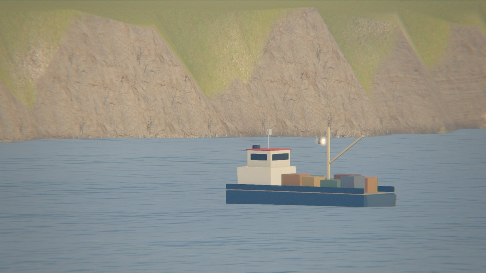

Vous êtes sur la galerie d'un phare, 34 m au-dessus de la mer. Dans la crique, un caboteur finit de charger : rien ne doit en sortir. Sept objectifs de 260 à 1 200 m, tous sur du matériel — la plaque de réglage sur son îlot, les feux des bouées du chenal, le boîtier du treuil de la grue, la radio et le projecteur du caboteur, le bidon de la barge de ravitaillement, le moteur du canot, la lanterne de la tourelle de la passe. Le tir est plongeant et le vent de mer souffle en rafales : lisez les fanions et tirez dans une accalmie. Pour la barge, il faut descendre au musoir de la digue par la trappe de la galerie, et tirer au ras de l'eau. Le canot est la seule cible qui se déplace : il s'arrête plusieurs secondes à chaque bouée de sa route, et vous avez un peu moins de quatre minutes avant qu'il ne passe la pointe. Bonus pour chaque objectif réussi sans balle perdue et pour un canot arrêté tôt.

#### Avancé : Le Château d'eau

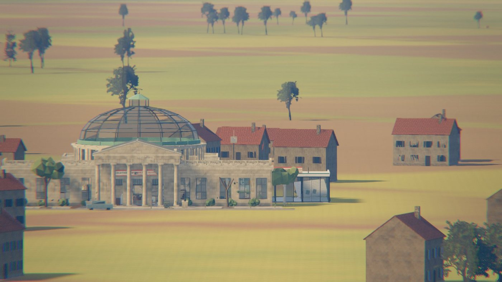

Vous êtes allongé sur la plate-forme d'un château d'eau, trente mètres au-dessus d'une plaine de champs et d'usines, et tout ce qui compte est autour de vous : tournez-vous. Sept sabotages à enchaîner de 900 à 2 400 m — l'émetteur d'un relais, les vannes d'une usine, un signal de chemin de fer, la citerne du convoi qu'il arrête, un drone au-dessus d'une villa, une lunette de surveillance dont le reflet vous trahit, et pour finir l'horloge de la gare. Aucune aide : la distance se vérifie au réticule, le vent se lit aux fanions, aux fumées et à la vapeur des vannes, la balistique est complète. Et la plaine écoute : chaque tir perdu fait monter l'alerte ; au quatrième d'affilée, l'objectif est à reprendre. Rien ne se tire en mouvement.

## Commandes

Les touches sont lues par position physique : ZQSD sur un clavier français, WASD sur un clavier anglais.

| Action | Touche |
|---|---|
| Se déplacer | Z Q S D (W A S D) |
| Regarder | Souris |
| Courir | Maj gauche |
| Accroupi / couché / se relever | C / X / Espace |
| Épauler ou quitter la lunette | Clic droit ou F |
| Tirer | Clic gauche |
| Retenir son souffle | Espace ou Maj, en lunette |
| Grossissement | Molette |
| Tourelle d'élévation | ↑ ↓ par pas de 0,1 mrad (Maj droite : 1 mrad) |
| Tourelle de dérive | ← → |
| Télémètre | T (cartes faciles et standard) |
| Recharger | R |
| Râtelier, changer d'arme | E, sous l'abri du site de tir |
| Carnet de tir | Tab |
| Relire le briefing | B |
| Afficher les images par seconde | H |
| Pause | Échap |
| Passer le tutoriel | P |
| Fermer ou rouvrir le conseil | Entrée |

On marche librement sur tout le site de tir, jusqu'à une limite visible : rebord de falaise, pente trop raide, mur ou clôture.

Après trois tirs manqués de suite sur une même cible, un encart « Conseil » rappelle la marche à suivre (mesurer la distance, lire le carnet, reporter l'élévation sur la tourelle, corriger le vent), avec les chiffres de l'arme en main et l'écart mesuré des impacts ; il signale aussi une arme mal adaptée à la distance et propose mieux au râtelier. Il ne met pas le jeu en pause et se ferme par Entrée (ou son bouton, au doigt) ; un bouton « Conseil » reste alors à l'écran pour le rouvrir. Sur téléphone, il se lit dans la lunette, sans quitter la visée. Il se coupe au menu (« Conseils : Sans »).

Couché, l'arme repose sur son bipied. Accroupi contre un appui, elle tremble deux fois plus ; sans appui, quatre fois plus. Le pouls monte quand on court et met une vingtaine de secondes à redescendre. Une boussole et une flèche guident vers le poste conseillé pour l'objectif en cours ; un losange bleu y marque la direction de la cible. Au sol aussi : debout, trois chevrons dorés aux pieds du tireur indiquent le chemin du pas de tir ; une fois en position, un cercle l'entoure, dont les pointes bleues donnent la direction des cibles de l'objectif (les pointes pâles, plus courtes, celles des objectifs suivants).

Le décor réagit aux balles. Une vitre traversée se brise, plus ou moins selon l'énergie à l'impact : sous 250 J (une .22 LR) la balle perce un trou étoilé ; au-delà le carreau tombe ; au-dessus de 2 500 J il est soufflé. Un carreau déjà fêlé cède au coup suivant. Une balle qui traverse la couronne d'un arbre en fait tomber des feuilles et des brindilles. Ni les vitres ni le feuillage n'arrêtent ou ne dévient la balle : ce sont des repères pour voir où elle est passée.

### Le mrad, l'élévation et le vent

Le jeu embarque un mode d'emploi illustré, « Régler la lunette », ouvert depuis l'accueil ou la pause, et directement par l'adresse du jeu suivie de `#lunette`. Cinq chapitres (le mrad, lire le réticule, l'élévation, la dérive, corriger après un tir), des schémas que l'on manipule et des vues de la lunette ; ses chiffres viennent du même calcul que le carnet de tir.

Tout le réglage se fait en mrad (milliradian). Un mrad est un angle : il couvre 10 cm à 100 m, 20 cm à 200 m, 1 m à 1 000 m. Le réticule est gradué dans cette unité, et les tourelles avancent par pas de 0,1 mrad.

- **Élévation** : la balle tombe en route. Le carnet de tir donne, pour la distance mesurée, l'angle qui compense cette chute ; on l'affiche à la tourelle d'élévation.
- **Tir manqué** : l'écart se lit sur le réticule. Un impact 2 mrad sous la cible se corrige en ajoutant 2 mrad d'élévation.
- **Vent** : la flèche de la rose des vents pointe là où le vent pousse la balle (vers le haut : dans l'axe du tir). Flèche vers la gauche, la balle part à gauche : on corrige la dérive vers la droite.

Le tutoriel de la carte facile (17 étapes) fait pratiquer tout cela sur deux plaques.

## Scores et classements

À la fin d'une mission réussie, le jeu affiche les vingt meilleurs scores du niveau joué. Si le score y entre, le joueur inscrit son nom : huit caractères au plus, lettres, chiffres, espace et tiret, en majuscules comme sur une borne d'arcade. Le dernier nom utilisé est proposé d'emblée ; « Passer » termine sans s'inscrire. L'accueil montre les cinq premiers de chaque carte de la campagne en cours (l'écran « Scores » passe d'une campagne à l'autre) (sur téléphone : bouton « Scores »).

- **Tirs d'adresse** : un tir en plein centre de la cible rapporte 250 points, un tir sur une cible en mouvement 400, dans la limite de 650 par objectif. Un compliment s'affiche à chaque fois. Ces points s'ajoutent au score avant le coefficient de difficulté.
- **Tri** : score décroissant ; à score égal, le premier inscrit reste devant. Vingt lignes par niveau.
- **En ligne** : quand le jeu est servi par son serveur (`npm start`, Docker, mais aussi `npm run dev` et `npm run preview`), le classement est commun à tous les joueurs et enregistré dans un fichier du serveur. L'écran l'indique : « en ligne ».
- **Local à cet appareil** : sur un hébergement statique simple, ou hors ligne, les scores restent dans le navigateur (`localStorage`) : ils ne sont visibles que sur cet appareil et dans ce navigateur, et disparaissent si l'on efface les données du site. Ce classement local se vide depuis l'écran « Commandes » (bouton « Effacer », avec confirmation).
- **Parties non classées** : une mission échouée ou abandonnée, et les parties d'essai (`?test`, aides forcées par `?d=`, objectifs sautés par `?step=`).

Le serveur vérifie chaque inscription (niveau connu, nom nettoyé, score entre le minimum et le maximum théoriques du niveau, champs cohérents, six inscriptions par minute et par adresse). Il n'y a ni compte ni preuve de partie : ces garde-fous écartent les valeurs absurdes et le remplissage en masse, pas un tricheur décidé qui envoie un score plausible.

## Sur téléphone

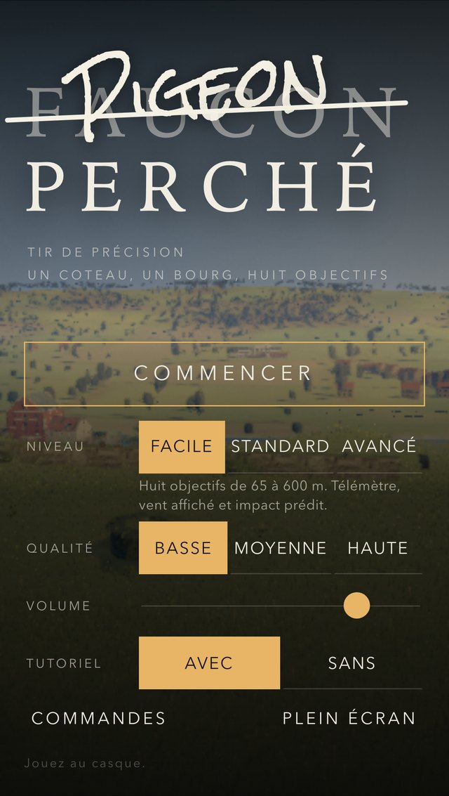 

Sur un appareil tactile, le jeu affiche ses commandes à l'écran et se joue en portrait ; à l'horizontale, il demande de redresser le téléphone. Les tablettes acceptent les deux sens.

- **Hors lunette** : manette flottante sous le pouce gauche, regard en glissant partout ailleurs, boutons de posture, d'épaulement et de rechargement sous le pouce droit.
- **En lunette** : le champ occupe le haut de l'écran ; dessous, les tourelles (0,1 et 1 mrad), le grossissement et le télémètre ; tout en bas, Souffle, Quitter et Tirer. Le doigt déplace la visée d'autant plus vite que le grossissement est faible, et une petite flèche au bord du champ indique la cible quand elle en est sortie.
- **Chargement** : le menu s'affiche avant la carte, et le relief, le ciel et les textures de la carte sélectionnée sont préchargés en arrière-plan, sauf en connexion limitée.
- **Gestes du navigateur neutralisés** : double tap, pincement de page, défilement élastique.
- **iPhone** : Safari n'offre pas de plein écran à une page web. Ajouter la page à l'écran d'accueil (Partager, puis « Sur l'écran d'accueil ») retire les barres du navigateur.

`?touch=1` et `?touch=0` forcent ou désactivent les commandes tactiles.

## Carabines et calibres

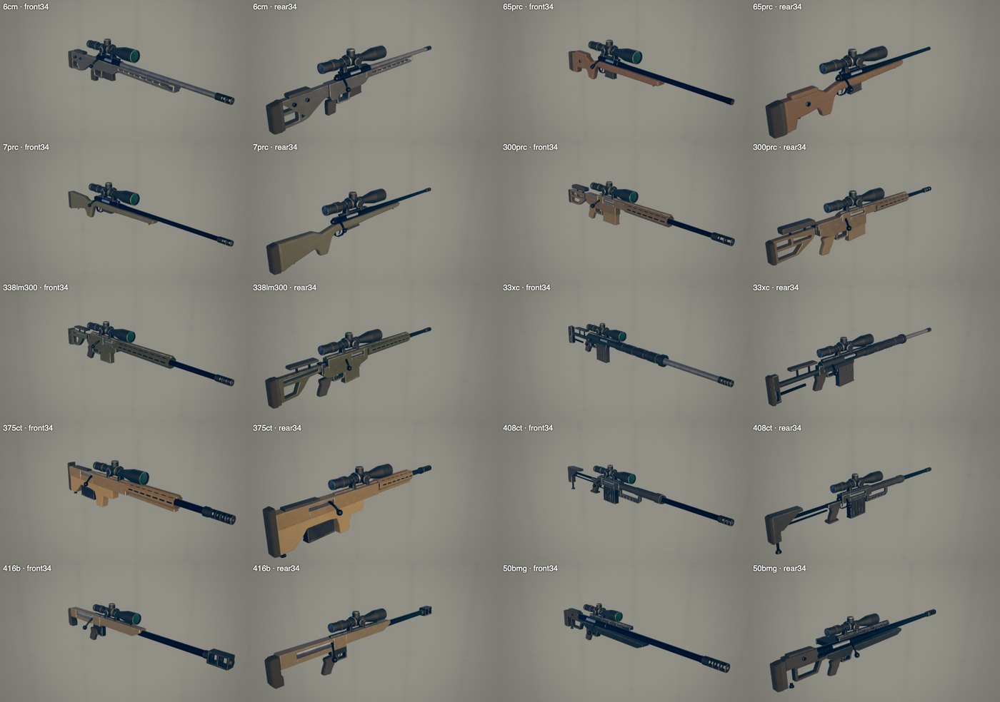

Chaque arme est une carabine réelle avec une munition réelle. Les modèles 3D sont construits par code d'après des photos de référence ; aucune image ni marquage de fabricant n'est embarqué.

| Gamme | Carabine | Calibre |
|---|---|---|
| Initiation | CZ 457 Varmint | .22 LR |
| Standard | Tikka T3x Tac A1 | .223 Rem, 6.5 Creedmoor |
| Standard | Ruger Precision Rifle | .308 Win, .308 subsonique avec modérateur |
| Standard | Sako TRG 42 | .300 Win Mag |
| Standard | PGM 338 | .338 Lapua Magnum |
| Intermédiaire | Savage 110 Elite Precision | 6 mm Creedmoor |
| Intermédiaire | Bergara B-14 HMR | 6.5 PRC |
| Intermédiaire | Seekins Havak PH2 | 7 mm PRC |
| Intermédiaire | Barrett MRAD | .300 PRC |
| Intermédiaire | Accuracy International AXSR | .338 Lapua Magnum, balle de 300 gr |
| Longue distance | Tubb Adaptive Target Rifle | .33 XC |
| Longue distance | Desert Tech HTI | .375 CheyTac |
| Longue distance | CheyTac M200 Intervention | .408 CheyTac |
| Longue distance | Barrett M99 | .416 Barrett |
| Longue distance | Steyr HS .50 M1 | .50 BMG |

Chaque niveau propose une partie de cet arsenal au râtelier (douze armes au plus).

## Balistique


- **Vol** : intégration de Runge-Kutta d'ordre 4, traînée G1 ou G7 selon la balle, vent échantillonné le long de la trajectoire, passage transsonique.
- **Effets avancés**, activés par niveau : force de Coriolis et effet Eötvös (latitude et azimut de tir), dérive gyroscopique (stabilité de Miller, formule de Litz), saut aérodynamique dû au vent traversier, densité de l'air selon l'altitude, la température et la pression, y compris le long d'une trajectoire qui descend dans une vallée.
- **Carnet de tir** (Tab) : table de l'arme en mrad. Sur le niveau avancé, il décompose la correction (chute, vent, dérive gyroscopique, Coriolis horizontal et vertical, saut aérodynamique), donne le temps de vol, le Mach à l'impact, la distance de passage transsonique, et la part à prendre en contre-visée quand la tourelle arrive en butée.
- **Ordres de grandeur à 2 500 m** : 4,6 à 5,7 s de vol, 1,5 à 2,5 m de dérive gyroscopique, 50 à 60 cm de Coriolis dans chaque axe.

Les données de munition (masse, vitesse, coefficient balistique, pas de rayure) et leurs sources sont en commentaire dans `src/config/weapons.ts`. Les tests comparent le solveur à des tables publiées par Lapua, Federal et Hornady ; les références sont dans `tests/reference-tables.json`.

Limites du modèle : les calibres .375 CheyTac, .408 CheyTac et .50 BMG volent en G1 faute de coefficient G7 publié, donc un peu trop bien dans le transsonique. Au-delà de 500 yards, les nouvelles charges ne sont validées que par cohérence physique, faute de tables publiées.

## Bâtiments, routes et rivières

Les bâtiments du décor (église, moulin, hôpital, château d'eau, sanatorium, aciérie, mine, tour de refroidissement, siège de la Compagnie, halte du passage à niveau…) viennent d'une banque de modèles générés par code, dans `src/buildings/bank/`. L'adaptateur `src/buildings/` les fusionne en deux maillages, fournit une version lointaine et enregistre leurs collisions : les murs arrêtent les balles, les fenêtres et les brèches les laissent passer.

Chaque bâtiment est relié au réseau de sa carte par une route, un chemin ou une allée inscrits dans le relief, avec un pont à chaque franchissement de rivière. Sur la carte avancée, une rivière traverse la plaine près de la centrale thermique, qui y puise par une station de pompage.

## Déploiement

Le jeu se déploie avec son petit serveur (`server/server.mjs`, Node seul, sans dépendance) : il sert `dist/` et l'API du classement (`GET` et `POST /api/scores`).

### Avec Docker

```bash
docker compose up -d --build     # construit l'image et lance le jeu sur le port 8080
```

ou, sans Compose :

```bash
docker build -t pigeon-perche .
docker run -d --name pigeon-perche -p 8080:8080 -v pigeon-scores:/data pigeon-perche
```

L'image est construite en deux étapes ; les fichiers sont précompressés en Brotli à la construction et servis avec un cache long, lié à une empreinte de leur contenu. L'image finale ne contient que `dist/` et le serveur, tourne sous un utilisateur non privilégié et déclare un contrôle de santé (`/healthz`). Le classement est dans le volume monté sur `/data` : il survit aux redémarrages et aux mises à jour de l'image.

### Sans Docker

```bash
npm install
npm run build
PORT=8080 SCORES_FILE=/var/lib/pigeon-perche/scores.json npm start
```

### Variables d'environnement

| Variable | Rôle | Valeur par défaut |
|---|---|---|
| `PORT` | port d'écoute | `8080` |
| `HOST` | adresse d'écoute | `0.0.0.0` |
| `SCORES_FILE` | fichier du classement | `data/scores.json` (dans l'image : `/data/scores.json`) |
| `DIST_DIR` | dossier servi | `dist` |
| `TRUST_PROXY` | `1` derrière un mandataire inverse : l'adresse du joueur est lue dans `X-Forwarded-For` | non |
| `SCORES_PER_MINUTE` | inscriptions permises par adresse et par minute | `6` |
| `SCORES_API` | `off` : pas d'API, le jeu retombe sur le classement local | activée |

Le serveur parle HTTP : pour le HTTPS, placez-le derrière un mandataire inverse (Caddy, nginx, Traefik) et mettez `TRUST_PROXY=1`, sans quoi tous les joueurs partagent la même limite de débit.

### Le fichier des scores

- **Format** : un fichier JSON, écrit de façon atomique (fichier temporaire puis renommage), relu à chaque requête.
- **Sauvegarde** : copier le fichier suffit. Avec Docker : `docker compose cp pigeon-perche:/data/scores.json ./scores-sauvegarde.json`.
- **Remise à zéro** : supprimer le fichier, sans redémarrer (`docker compose exec pigeon-perche rm /data/scores.json`). Il n'y a volontairement aucun bouton public pour cela.
- **Retirer une ligne** : éditer le fichier à la main ; s'il devient illisible, le serveur le met de côté (`scores.json.illisible-<date>`) et repart d'un classement vide.
- **En développement** : `npm run dev` et `npm run preview` offrent la même API, avec le même code ; le fichier est `data/scores.json` (dossier ignoré par git), ou celui que désigne `SCORES_FILE`.

## Tests

```bash
npm test                 # tests unitaires (balistique, vol, lots des bâtiments, classement, conseils, tirs d'adresse, cartes)
npm run build            # vérification des types puis construction
```

Tests de bout en bout (après `npm run e2e:install`). Chaque script accepte `-- --level <carte>` (`facile`, `standard`, `avance`, `fete`, `phare`, `plaine`) et vise `standard` par défaut :

```bash
npm run e2e:smoke        # menu, briefing, jeu, carnet, pause
npm run e2e:mission      # un tireur automatique joue toute la mission
npm run e2e:mission:portrait
npm run e2e:matrix       # chaque cible est visible d'au moins un poste
npm run e2e:walk         # parcours à pied vers chaque poste, et marche droit vers le bord dans huit directions
npm run e2e:mobile       # commandes tactiles en portrait
npm run e2e:tutorial     # les 17 étapes du tutoriel
npm run e2e:rifles       # cotes et coût des 17 modèles d'armes
npm run e2e:physics      # tir réel contre solution calculée, effets avancés
npm run e2e:buildings    # banc d'essai des bâtiments
npm run e2e:perf         # temps par image des vues de référence
npm run e2e:scores       # classements : API du serveur, repli local, ordinateur et portrait (lance son propre serveur sur dist/)
npm run e2e:coach        # conseil après tirs manqués
HR_URL=http://127.0.0.1:4173/ PLAYWRIGHT_BROWSERS_PATH=0 node e2e/menu.mjs          # menu affiché avant la carte, chargement au clic (avec npm run preview)
HR_URL=http://127.0.0.1:4173/ PLAYWRIGHT_BROWSERS_PATH=0 node e2e/coach-button.mjs  # bouton qui rouvre le conseil
PLAYWRIGHT_BROWSERS_PATH=0 node e2e/zone.mjs     # zone de marche : aucune limite invisible
PLAYWRIGHT_BROWSERS_PATH=0 node e2e/routes.mjs   # captures des voies d'accès et des cours d'eau
```

Les scripts lancent leur propre serveur ; la variable `HR_URL` les dirige vers un serveur déjà lancé (par exemple `HR_URL=http://127.0.0.1:4173/` avec `npm run preview`). Les captures vont dans `e2e/out/`.

## Organisation du code

```
index.html, vite.config.ts     point d'entrée et configuration
server/        serveur de production : fichiers statiques et API du classement
Dockerfile, docker-compose.yml  image et lancement sur un serveur
src/
  core/        moteur de rendu, post-traitement, entrées, chargement des assets
  levels/      un dossier par carte (facile, standard, avance, fete, phare, plaine) + le contrat dans README.md
  world/       relief, végétation, ciel, vent, eau, mer et houle, maçonnerie
  buildings/   adaptateur et banque de bâtiments
  ballistics/  solveur, environnement, vol, solution de tir
  config/      fiches des armes
  weapons/     mécanique de la carabine, lunette, modèles 3D
  player/      déplacements et personnage
  game/        boucle de jeu, tirs, cibles, mission, tutoriel, classements, conseils
  game/extra/  mécaniques de cible des cartes « Lieux oubliés » (fête foraine, mer, sabotage)
  shared/      cœur du classement, commun au jeu et au serveur
  audio/       moteur sonore synthétisé ; tir hybride (attaque enregistrée, shot-*.ts)
  ui/          interface, commandes tactiles, styles
public/        relief, textures, modèles, ciel, images du fond de menu, police du titre, icônes
tools/         générateur de relief et d'icônes
tests/         tests unitaires (Vitest)
e2e/           tests de bout en bout (Playwright)
docs/captures/ images de ce README
```

Pour ajouter une carte, lisez `src/levels/README.md` : un niveau est un dossier ; son identifiant, sa campagne et ses règles de score se déclarent dans le socle (`src/levels/index.ts`, `src/shared/scores-core.mjs`).

## Licences

Assets (textures, modèles, ciel, police) et bibliothèques : voir [CREDITS.md](CREDITS.md). Les textures, modèles et ciel sont sous CC0 ; three.js, postprocessing et three-mesh-bvh sous licence MIT ; la police du titre, Rock Salt, sous Apache 2.0.
